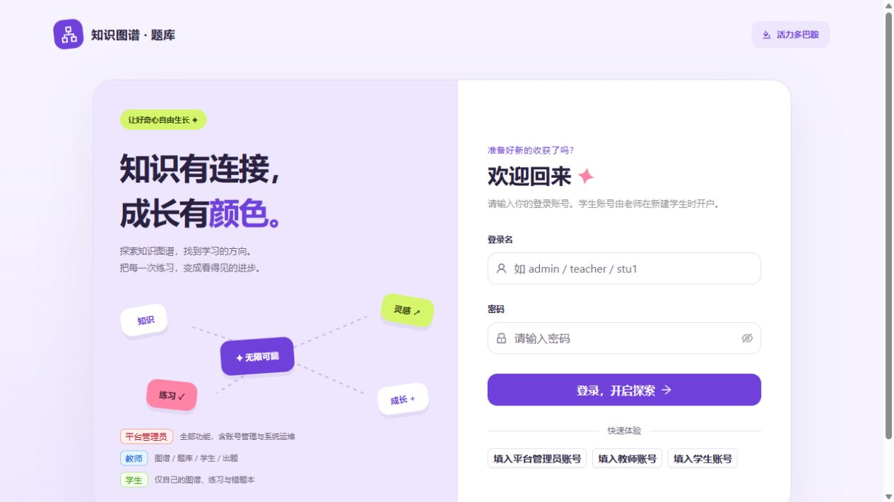
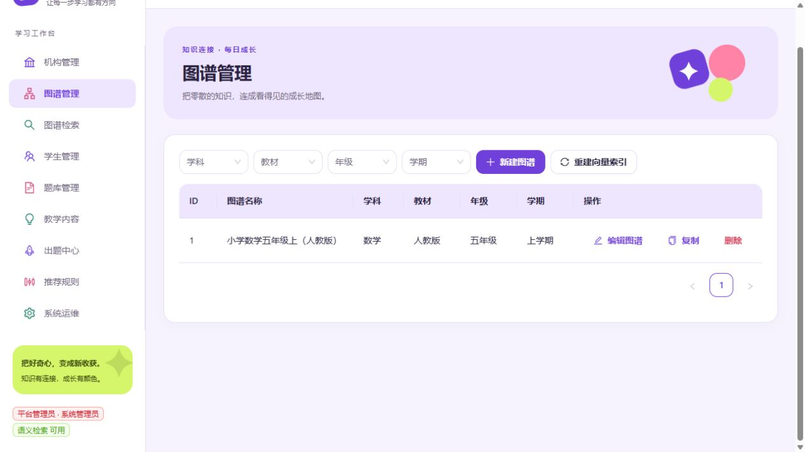
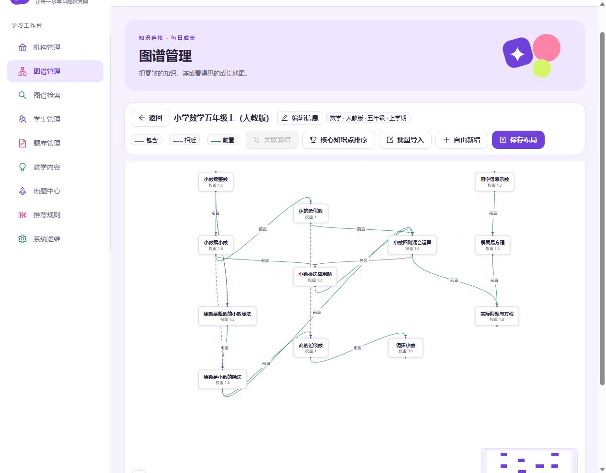

# 数学知识图谱教学与自适应练习平台

[项目首页 / Overview](README.md) | [中文说明](README.zh-CN.md) | [English guide](README.en.md)

面向管理员、教师和学生的教学 Demo：把知识点关系、题库、练习和学情反馈连接起来，支持教师组织教学与学生针对薄弱知识点练习。示例内容为小学数学。

## 功能

- **知识图谱**：按学科、教材、年级、学期管理；画布编辑知识点及包含、相近、前置关系，支持模板复制和大纲导入。
- **题库与检索**：题目关联知识点，支持批量导入、精确与关键词检索，以及本地 embedding 驱动的语义检索。
- **教学闭环**：学生个人图谱、掌握度追踪、自适应出题、组卷与定向发布、学生答题、自动评分及教师复核。
- **学习分析**：学情报告、错题本、前置缺口分析、学习路径推荐与核心知识点排序。
- **角色权限**：管理员管理账号及系统，教师管理教学，学生访问自己的学习数据；后端校验角色与数据归属。
- **可选 AI**：通过兼容接口辅助内容生成与题目识别。
- **多主题界面**：右上角可切换活力多巴胺、蜜桃派对、薄荷花园、晴空蓝与霓虹夜色；选择自动保存在当前浏览器，登录页、工作台、弹窗与图谱同步换色。

## 当前架构

| 部分 | 技术与职责 |
|---|---|
| 前端 | React 18、Vite 5、Ant Design 5、React Flow 12 |
| 后端 | Java 17、Spring Boot 3.4.5、MyBatis-Plus |
| MySQL 8 | 用户、学生、题目、练习、作业、答题与掌握度等业务数据 |
| Neo4j | 图谱、知识点及关系；Cypher 操作集中在 GraphStore |
| Qdrant | 知识点向量检索 |
| ONNX Runtime | 本地 bge-small-zh-v1.5 中文 embedding，512 维 |

Neo4j 是当前图存储，MySQL 是业务存储。Qdrant、embedding 与大模型能力分别由环境变量控制。

## 快速开始

准备 Java 17、Maven、Node.js/npm、MySQL 8 和可用的 Neo4j 服务；需要语义检索时准备 Qdrant。数据库与服务数据不包含在仓库中。

```sh
git clone https://github.com/Crazy4Lamb/kg-quiz.git
cd kg-quiz
```

### 1. 配置服务

以下为 PowerShell 示例，将密码改成你的实际配置：

```powershell
$env:MYSQL_HOST = "127.0.0.1"
$env:MYSQL_PORT = "3306"
$env:MYSQL_USER = "root"
$env:MYSQL_PASSWORD = "your-mysql-password"
$env:NEO4J_URI = "bolt://127.0.0.1:7687"
$env:NEO4J_USER = "neo4j"
$env:NEO4J_PASSWORD = "your-neo4j-password"
$env:QDRANT_URL = "http://127.0.0.1:6333"
```

MySQL 连接配置默认创建 yt_knowledge_demo 数据库，并执行 schema.sql 与 migration.sql；所用账号需要相应权限。Neo4j 服务与认证需提前配置。

### 2. 启动后端

在上面的终端中：

```powershell
cd backend
mvn spring-boot:run
```

后端端口为 **8090**。从 backend 目录运行时，模型默认从 ../models/ 加载。

### 3. 启动前端

另开终端，在项目根目录执行：

```sh
cd frontend
npm ci --ignore-scripts
npm run dev
```

打开 http://localhost:5173。Vite 将 /api 请求代理到 http://localhost:8090。

Windows 可使用 start-backend.bat 与 start-frontend.bat，但后端脚本的 JAVA_HOME 和 Maven 路径目前为原开发电脑路径，换电脑时需调整，或使用上述命令。

### 4. 体验教学流程

首次启动的演示账号：管理员 admin / admin123，教师 teacher / teacher123。演示学生 stu1 / 123456 需要相应学生数据已创建。

管理员导入示例数据后，可查看图谱、学生和题目；教师组卷并发布，学生作答，教师复核并查看掌握度变化。共享部署前应修改演示密码。

## 模型文件

仓库已包含 models/bge-small-zh-v1.5.onnx（94,851,877 字节，约 90.46 MiB）与 models/tokenizer.json，普通 git clone 会下载完整模型，无需 Git LFS 或另行下载。

原开发说明标注模型来自 Xenova/bge-small-zh-v1.5。可通过 KG_EMBEDDING_MODEL、KG_EMBEDDING_TOKENIZER 覆盖路径；替换模型时需匹配 tokenizer 和 embedding 维度。

## 常用配置

| 环境变量 | 用途 |
|---|---|
| MYSQL_HOST / MYSQL_PORT / MYSQL_USER / MYSQL_PASSWORD | MySQL 连接 |
| NEO4J_URI / NEO4J_USER / NEO4J_PASSWORD / NEO4J_DATABASE | Neo4j 连接 |
| QDRANT_URL / QDRANT_ENABLED | 向量服务地址与开关 |
| KG_EMBEDDING_ENABLED / KG_EMBEDDING_MODEL / KG_EMBEDDING_TOKENIZER | 本地模型开关与路径 |
| LLM_ENABLED / LLM_BASE_URL / LLM_API_KEY / LLM_MODEL | 可选大模型能力 |

配置默认值见 backend/src/main/resources/application.yml。dev profile 包含原开发环境的内网服务地址，新环境请覆盖。密钥使用环境变量，不写入 Git。

Qdrant 不可达或模型无法加载时，语义检索可降级为关键词匹配；这不代表 MySQL 或 Neo4j 可以省略。

## 目录与开发

```text
backend/       Java API、权限、业务逻辑与数据库脚本
frontend/      React 网页
models/        ONNX 模型与 tokenizer
docs/          开发说明与检查结果
start-*.bat    原开发电脑的 Windows 启动脚本
```

前端构建：在 frontend 目录执行 npm run build。后端检查：在 backend 目录执行 mvn test。根目录的验证脚本可能依赖运行中的服务、演示数据或原电脑路径，运行前请阅读脚本。

[历史开发说明](docs/legacy-demo-guide.zh-CN.md)保留详细流程与接口示例，其中旧架构描述不应作为当前部署依据。

## 图解使用说明

### 1. 登录与选择主题



使用管理员、教师或老师分配的学生账号登录。右上角的主题按钮可选择活力多巴胺、蜜桃派对、薄荷花园、晴空蓝、霓虹夜色，选择保存在当前浏览器，登录页和工作台同步换色。

### 2. 管理知识图谱



管理员或教师在「图谱管理」中按教材与年级选择图谱，点击「编辑图谱」。空库可通过「导入示例数据」体验；已有教学数据时可直接使用现有图谱。



- 拖动知识点调整位置，点击「保存布局」保存。
- 双击节点编辑属性；从节点连接点拖线建立关系。
- 点击连线调整包含、相近或前置关系及方向。
- 选中节点后用「关联新增」补充知识点；「批量导入」可粘贴缩进大纲。

### 3. 完成一次教学闭环

| 角色 | 操作 | 结果 |
|---|---|---|
| 管理员 / 教师 | 新建学生，选择教材并创建账号 | 生成学生个人知识图谱 |
| 教师 | 维护题库并关联知识点 | 为练习与组卷准备题目 |
| 教师 | 在出题中心自适应出题，或组卷并定向发布 | 学生收到练习或作业 |
| 学生 | 打开「我的作业」，作答并提交 | 系统执行自动评分 |
| 教师 | 在批改台复核主观题并定稿 | 学生查看最终评分与评语 |
| 教师 / 学生 | 查看「我的学习」、学情报告和错题本 | 按薄弱点继续练习 |

截图来自当前项目界面；展示的是数学演示图谱，不包含真实学生记录。
